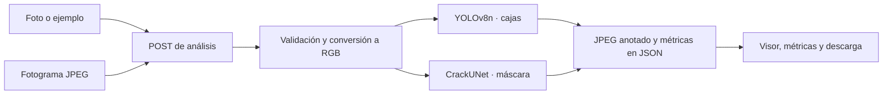

# RoadVision AI · Detector de baches y grietas

Desarrollamos RoadVision AI para inspeccionar visualmente el pavimento a partir de fotografías y fotogramas de cámara web. Procesamos cada imagen con dos modelos propios. Localizamos los baches con cajas y puntuaciones de confianza, y segmentamos las grietas por píxel. Mostramos ambas salidas sobre el mismo JPEG para que se puedan comparar con la fuente original y descargar.

Integramos un asistente en español con el Transformer RoadVision V4. El modelo interpreta la intención de la pregunta y Django redacta la respuesta con los datos de la última inspección disponible.

## Contenido

- [Alcance y conceptos](#alcance-y-conceptos)
- [Conceptos clave para interpretar el análisis](#conceptos-clave-para-interpretar-el-análisis)
- [Tecnologías](#tecnologías)
- [Instalación y uso](#instalación-y-uso)
- [Implementación paso a paso](#implementación-paso-a-paso)
- [Modelos y métricas](#modelos-y-métricas)
- [Asistente Transformer V4](#asistente-transformer-v4)
- [Mapa del código](#mapa-del-código)
- [Contrato HTTP](#contrato-http)
- [Configuración y despliegue](#configuración-y-despliegue)
- [Verificación y diagnóstico](#verificación-y-diagnóstico)

## Alcance y conceptos

| Concepto | Cómo lo aplicamos |
| --- | --- |
| Bache | Localizamos una depresión o cavidad visible en el pavimento mediante una **caja delimitadora**. Cada caja representa una predicción del detector. |
| Grieta | Identificamos zonas con fisuras visibles. El segmentador asigna una probabilidad a cada píxel y construimos una **máscara booleana** con el umbral operativo. |
| Inferencia | Ejecutamos los grafos exportados con sus pesos entrenados. La aplicación recibe una imagen, prepara sus tensores y transforma las salidas en datos interpretables. |
| Confianza de una caja | Presentamos la puntuación que entrega YOLOv8n para una caja concreta. La usamos para ordenar candidatos y decidir cuáles pasan el filtro inicial. |
| Cobertura de grietas | Dividimos los píxeles marcados por el total de píxeles de la imagen analizada y multiplicamos por 100. La unidad es porcentaje de la imagen completa. |
| Modelo y datos de entrenamiento | Integramos las exportaciones de dos entrenamientos propios. Conservamos los metadatos que identifican las épocas seleccionadas, los parámetros y las métricas disponibles. |

Asignamos **ámbar** a los baches y **magenta** a las grietas. El conteo de baches corresponde a cajas después de la supresión de solapamientos. La máscara de grietas puede representar varias fisuras conectadas o separadas, por lo que informamos su cobertura en píxeles.

## Conceptos clave para interpretar el análisis

### Datos, entrenamiento y evaluación

| Concepto | Cómo lo aplicamos |
| --- | --- |
| **Anotación de referencia** (*ground truth*) | Comparamos las predicciones con daños etiquetados. Para baches usamos cajas de referencia. Para grietas usamos máscaras de referencia por píxel. |
| **Entrenamiento, validación y prueba** | Usamos entrenamiento para ajustar los pesos y validación para comparar configuraciones y seleccionar umbrales. Reservamos la partición de prueba para medir el desempeño de una configuración elegida. |
| **Época y checkpoint** | Llamamos época a una pasada por el conjunto de entrenamiento. Un checkpoint guarda el estado del modelo en un punto del entrenamiento. Exportamos a ONNX las versiones seleccionadas para la aplicación. |
| **Fuga de datos** | Al planear una evaluación independiente, agrupamos las escenas repetidas o los fotogramas muy próximos de un mismo recorrido en una sola partición. Así evitamos que el modelo sea evaluado con escenas que ya vio al entrenarse. |
| **Generalización** | Evaluamos con escenas representativas de las condiciones de uso. Consideramos diferencias de iluminación, textura del pavimento, distancia, ángulo y movimiento de la cámara, porque pueden cambiar el desempeño respecto del conjunto de referencia. |

### Confianza, umbral y cobertura

- Usamos la **confianza** de cada caja para filtrar esa predicción. Una confianza de `0.68` describe la puntuación de esa caja. Calculamos la precisión del modelo sobre un conjunto de predicciones con anotaciones de referencia.
- El **umbral operativo** decide qué candidatos o píxeles entran al resultado. En baches lo aplicamos antes de la supresión de cajas. En grietas lo aplicamos a cada píxel del mapa reescalado. Al bajar el umbral podemos recuperar daños de menor puntuación y admitir más marcas erróneas.
- Para calcular la **cobertura**, usamos como denominador el total de píxeles de la imagen analizada. Una máscara con 2.000 píxeles marcados en una imagen de 200.000 píxeles tiene una cobertura del **1 %**. Para estimar un área física del pavimento necesitaríamos una escala y una calibración de la perspectiva.

Si el modelo marca **10 cajas**, **8** coinciden con baches distintos y la imagen contiene **12** baches de referencia, obtenemos **80 % de precisión** (`8 / 10`) y **66,67 % de sensibilidad** (`8 / 12`). Para determinar cuáles cajas coinciden, medimos el IoU entre predicción y anotación. En la supresión de cajas duplicadas usamos el IoU entre dos predicciones del modelo.

### Píxeles, coordenadas y resolución

- En el **tensor de entrada**, organizamos los píxeles RGB en ejes de lote, canal, alto y ancho. Ambas redes reciben un lote unitario y valores normalizados de 0 a 1. Cada modelo espera su propio tamaño de entrada.
- Distinguimos **tres resoluciones**. Una foto orientada de **2.400 × 1.200 px** se reduce a **1.600 × 800 px** antes de construir las entradas de **768 × 768 px** y **384 × 384 px**. Recuperamos las cajas y la máscara en la resolución analizada de **1.600 × 800 px**.
- En el **sistema de coordenadas**, contamos `x` desde la izquierda y `y` desde arriba. Al dibujar resultados en otra resolución, usamos la transformación entre la imagen analizada y el área donde se muestra. Incluimos el ancho y el alto en la respuesta para poder reconstruir esa correspondencia.

### Validación de la aplicación y del modelo

Comprobamos dos aspectos por separado. En la aplicación verificamos que la foto o el fotograma llegue a Django y que podamos ver y descargar el resultado. En los modelos medimos la coincidencia con imágenes etiquetadas. Para repetir una medición registramos la versión y el SHA-256 de los ONNX, los umbrales, el preprocesamiento, la resolución evaluada y la partición utilizada. [Modelos y métricas](#modelos-y-métricas) · [Verificación y diagnóstico](#verificación-y-diagnóstico)

## Tecnologías

| Tecnología | Responsabilidad y motivo de uso |
| --- | --- |
| **Python 3.13** | Verificamos el entorno de ejecución con esta versión. Escribimos en Python las rutas, la validación, los predictores y la generación de resultados. |
| **Django 5.2** | Usamos rutas, vistas, plantillas, archivos estáticos, middleware de seguridad y validación CSRF en una sola aplicación web. |
| **HTML5 y plantillas Django** | Renderizamos la interfaz, resolvemos las rutas de los recursos y publicamos el token CSRF y el límite de archivo. |
| **CSS** | Usamos Grid y Flexbox para distribuir los paneles, y media queries para adaptar el visor y los controles a pantallas estrechas. |
| **JavaScript con módulos ES** | Controlamos la interfaz, la selección de archivos, la cámara y el análisis asíncrono con las APIs nativas del navegador. |
| **ONNX y ONNX Runtime** | Empaquetamos los grafos y pesos en ONNX. Ejecutamos la inferencia con el proveedor de CPU de ONNX Runtime. |
| **PyTorch** | Reconstruimos el Transformer del paquete V4 y cargamos su checkpoint para exportarlo a ONNX. Django usa la exportación en CPU con las dependencias existentes de ejecución. |
| **NumPy** | Representamos píxeles y tensores, calculamos áreas y solapamientos y aplicamos la máscara mediante operaciones vectorizadas. |
| **OpenCV sin interfaz gráfica** | Reescalamos imágenes y probabilidades, dibujamos cajas y texto y codificamos la salida JPEG en el servidor. |
| **Pillow** | Abrimos imágenes JPEG, PNG y WebP, verificamos sus dimensiones y corregimos la orientación EXIF antes de producir RGB. |
| **Vercel y WSGI** | Publicamos la aplicación y sus recursos estáticos con el soporte de Django de Vercel. WSGI es la interfaz entre el servidor HTTP y la aplicación Python. |
| **Git y pip** | Versionamos código, metadatos y pesos, y declaramos las dependencias de ejecución en `requirements.txt`. |

El archivo [requirements.txt](requirements.txt) establece los rangos compatibles de Django, NumPy, ONNX Runtime, OpenCV y Pillow. Para entender el motor de ejecución y su proveedor de CPU, consultamos la [referencia de ONNX Runtime](https://onnxruntime.ai/docs/api/python/api_summary.html).

## Instalación y uso

### Preparar el entorno

Partimos de la raíz del repositorio. Usamos Python de 64 bits y mantenemos las dependencias en un entorno virtual. Los dos pesos ONNX y sus archivos JSON están en `modelos/`. El análisis lee estos archivos directamente y la configuración del proyecto prescinde de una base de datos.

En **Windows PowerShell** usamos el intérprete del entorno virtual.

```powershell
python -m venv .venv
.\.venv\Scripts\python.exe -m pip install -r requirements.txt
.\.venv\Scripts\python.exe manage.py check
.\.venv\Scripts\python.exe manage.py runserver
```

En **Linux** usamos las rutas del entorno virtual de ese sistema.

```bash
python3 -m venv .venv
.venv/bin/python -m pip install -r requirements.txt
.venv/bin/python manage.py check
.venv/bin/python manage.py runserver
```

Abrimos [RoadVision AI en localhost](http://localhost:8000/). Usamos `manage.py check` para revisar la configuración y el análisis del ejemplo para comprobar que los pesos se cargan y ambas sesiones ejecutan inferencia.

### Analizar una fotografía

1. Abrimos **Archivo**. Pulsamos **Seleccionar imagen** o arrastramos un JPG, PNG o WebP estático. Podemos pulsar **Analizar imagen** directamente para usar el ejemplo de la aplicación.
2. Revisamos la vista previa y pulsamos **Analizar imagen**. El archivo ocupa un solo campo del formulario.
3. Consultamos el conteo de baches y el porcentaje de cobertura. Si tenemos cajas, abrimos **Confianza por detección de bache** para ver sus puntuaciones.
4. Alternamos entre **Original** y **Detecciones**. Usamos **Descargar imagen anotada** para guardar el JPEG combinado.

### Analizar desde cámara web

1. Elegimos **Cámara web**, pulsamos **Activar cámara** y autorizamos el vídeo en el navegador. Ejecutamos el sitio desde `localhost` o HTTPS para que el navegador permita la solicitud. [Requisitos de acceso a la cámara](https://developer.mozilla.org/en-US/docs/Web/API/MediaDevices/getUserMedia)
2. En **Analizar un fotograma**, el navegador toma la imagen que se está reproduciendo y la envía por la misma ruta que usamos para una foto.
3. En **Analizar en vivo**, esperamos cada respuesta antes de programar la siguiente captura. Añadimos una espera de **450 ms** después de una respuesta exitosa. La frecuencia depende de la cámara, la codificación, la red y la inferencia.
4. En modo cámara, **Original** muestra el vídeo en directo y **Detecciones** muestra el último fotograma que terminó de procesarse. **Detener análisis en vivo** para el envío periódico. **Apagar cámara**, cambiar de fuente o salir de la página libera las pistas de vídeo.

Solicitamos vídeo sin audio. Preferimos la cámara trasera cuando existe y pedimos una resolución ideal de 1.280 por 720 píxeles. La captura se codifica como JPEG con calidad solicitada de 0,9 y se reduce proporcionalmente cuando su lado mayor supera 1.280 píxeles.

### Límites y tratamiento de imágenes

| Operación | Criterio que aplicamos |
| --- | --- |
| Selección en navegador | Comprobamos la cantidad de archivos, el límite en bytes y la extensión o el tipo MIME como filtro inicial. |
| Subida a Django | Limitamos cada archivo a **10 MiB** (10.485.760 bytes). El manejador de carga interrumpe el archivo al superar ese tamaño. |
| Validación del contenido | Pillow abre únicamente JPEG, PNG y WebP. Rechazamos las imágenes animadas y limitamos la imagen original a **24 millones de píxeles**. |
| Orientación | Aplicamos EXIF antes de obtener la matriz RGB. |
| Resolución de análisis | Reducimos el lado mayor a **1.600 píxeles** cuando hace falta y mantenemos la proporción. Las coordenadas y la máscara corresponden a esta imagen. |
| Persistencia | Procesamos la imagen para responder a la solicitud y usamos los manejadores de memoria o archivos temporales de Django. La aplicación prescinde de un historial de análisis. |
| Formato de salida | Codificamos un JPEG de calidad 92 y lo devolvemos como URL de datos en JSON. El navegador puede mostrarlo o descargarlo con el nombre `roadvision-detecciones.jpg`. |

Django aplica sus propios límites de formulario además del límite del archivo. Vercel puede aplicar un límite de cuerpo de solicitud o respuesta antes de que Django procese la imagen. [Carga de archivos en Django](https://docs.djangoproject.com/en/5.2/topics/http/file-uploads/) · [Límites de Vercel Functions](https://vercel.com/docs/functions/limitations)

## Implementación paso a paso

Ambas fuentes usan el mismo servicio de Django. Unificamos la validación y el contrato de respuesta para aplicar los mismos criterios a una fotografía y a un fotograma.



1. **Construimos la interfaz.** La vista de inicio resuelve la plantilla con la URL de análisis, el archivo de ejemplo, el token CSRF y el límite de archivo. Organizamos el espacio en tres paneles y vinculamos sus identificadores con los módulos JavaScript.
2. **Unificamos la entrada.** Convertimos la captura de cámara a un Blob JPEG y descargamos el ejemplo como Blob cuando se solicita. El usuario conserva la vista previa del archivo local mediante una URL de objeto. Todas las imágenes salen en un `FormData` con el campo `imagen` y el token `X-CSRFToken`.
3. **Validamos la solicitud.** Django comprueba CSRF antes de llamar a la vista de análisis. Dentro de la vista validamos el método y el archivo, corregimos la orientación y obtenemos una matriz `uint8` de alto por ancho por tres canales RGB.
4. **Cargamos los grafos.** Abrimos los pesos locales, comparamos el SHA-256 con el JSON y creamos una sesión ONNX Runtime por predictor. Usamos un candado durante el acceso inicial a una caché de un par de modelos por proceso. Liberamos el candado antes de ejecutar la inferencia de la imagen.
5. **Ejecutamos ambos modelos.** Aplicamos la detección de baches y la segmentación de grietas a la misma matriz RGB, con los umbrales que centralizamos en Django. Cada predictor transforma la entrada según su tamaño y recupera la geometría de la imagen analizada.
6. **Componemos la salida.** Copiamos la imagen, pintamos la máscara de grietas y luego dibujamos las cajas ámbar y sus etiquetas. Convertimos a BGR para que OpenCV codifique correctamente los colores del JPEG. Calculamos la cobertura a partir de la máscara booleana antes de la codificación.
7. **Presentamos el resultado.** JavaScript actualiza el visor, las métricas, el desplegable y el enlace de descarga. Cancelamos solicitudes que quedan obsoletas al cambiar de fuente y descartamos respuestas que llegan después de la cancelación.

### Detección de baches con YOLOv8n

Usamos la época 10 de RoadVisionAI V6 Continuación. El grafo ONNX devuelve candidatos de una clase con el formato `[lote, 5, candidatos]`. Los cinco valores por candidato son centro horizontal y vertical, ancho, alto y confianza.

1. Aplicamos **letterbox**. Escalamos de forma uniforme y centramos la foto en un lienzo de **768 × 768** con relleno gris RGB 114. Guardamos los desplazamientos y la escala efectiva de cada eje para poder deshacer el redondeo.
2. Convertimos el orden de la imagen `HWC` (alto, ancho, canales) a `NCHW` (lote, canales, alto, ancho). Agregamos un lote de tamaño uno, usamos `float32` contiguo y dividimos entre 255.
3. Aplicamos **TTA** (*Test-Time Augmentation* o aumentos durante la inferencia). Ejecutamos el mismo grafo con las escalas **1,0**, **0,83 con volteo horizontal** y **0,67**. Alineamos las vistas reducidas a múltiplos de 32 con relleno normalizado `0.447`. Deshacemos los aumentos y recortamos las colas de candidatos de las vistas extremas según el protocolo original.
4. Conservamos candidatos finitos con confianza **mayor que 0,15** y limitamos a 30.000 el conjunto que ordenamos por confianza. Convertimos centro y tamaño en coordenadas de esquina `[x1, y1, x2, y2]`.
5. Aplicamos **NMS** (*Non-Maximum Suppression* o supresión de no máximos). Tomamos la caja de mayor confianza y descartamos candidatos con **IoU mayor que 0,60** respecto de ella. El IoU de cajas es el área de intersección dividida por el área de unión. Conservamos hasta **300** cajas.
6. Restamos el relleno, deshacemos las escalas y recortamos las cajas a los límites de la imagen original del análisis. Entregamos cajas, clase y confianza en el JSON.

Por ejemplo, una caja con confianza `0.18` supera el filtro de `0.15`. Su inclusión final depende de la supresión por solapamiento y el máximo de cajas. El JSON del modelo contiene el umbral histórico de la exportación, usado por el predictor cuando se invoca sin una anulación explícita.

### Segmentación de grietas con CrackUNet

Usamos la época 20 de CrackUNet, una arquitectura U-Net de segmentación binaria con ancho base 16. Para esta tarea, el modelo estima una probabilidad de pertenencia a la clase grieta por píxel.

1. Reescalamos la foto y la centramos con relleno gris en un cuadrado de **384 × 384**. Recordamos exactamente la región que pertenece a la foto.
2. Alimentamos la entrada `images` con un tensor RGB `NCHW` de lote uno, tipo `float32` y valores normalizados por 255.
3. Extraemos el mapa `probabilities` del grafo. Retiramos el relleno del mapa y lo interpolamos al ancho y alto de la imagen analizada.
4. Aplicamos el umbral operativo con la comparación **mayor o igual que 0,947**. Obtenemos una máscara donde cada valor verdadero marca un píxel de grieta.
5. Pintamos los píxeles verdaderos usando **60 % magenta y 40 % del color original**. Dividimos el número de píxeles verdaderos entre el tamaño total de la máscara para calcular el porcentaje de cobertura.

Aumentar el umbral exige una puntuación mayor y reduce el conjunto de píxeles marcados. Entre los píxeles que descartamos puede haber tanto falsos positivos como grietas reales de menor puntuación.

## Modelos y métricas

### Archivos y procedencia

| Archivo | Contenido |
| --- | --- |
| [baches.onnx](modelos/baches.onnx) | Grafo y pesos de detección exportados de YOLOv8n. Pesa 12.092.275 bytes. |
| [baches.json](modelos/baches.json) | Ficha de detección con parámetros, métricas históricas de test y huellas de exportación. |
| [grietas.onnx](modelos/grietas.onnx) | Grafo y pesos de segmentación CrackUNet. Pesa 1.956.379 bytes. |
| [grietas.json](modelos/grietas.json) | Ficha del segmentador con parámetros, procedencia del dataset, validación, prueba y huella ONNX. |

Integramos el detector a partir de la corrida de continuación iniciada con el checkpoint propio `v6_rtx4060ti_desde_cero`. Integramos el segmentador entrenado desde cero con Crack-Seg. Sus metadatos registran **3.717 imágenes de entrenamiento**, **200 de validación** y **111 de prueba**, además de la exclusión de un duplicado. El conjunto incluye imágenes de carreteras y paredes. [Descripción de Crack-Seg](https://docs.ultralytics.com/datasets/segment/crack-seg/)

Los JSON usan sintaxis JSON estándar. Documentamos sus campos aquí y validamos cada huella al abrir el archivo ONNX correspondiente.

### Campos de `baches.json`

| Campo | Uso o significado |
| --- | --- |
| `schema_version` | Identificamos la versión de la estructura de la ficha. |
| `model` y `selected_epoch` | Identificamos la corrida YOLOv8n Continuación y su época seleccionada. |
| `labels` y `source_names` | Registramos la clase `Bache` y su asociación con el índice 0 del modelo de origen. |
| `image_size` | Leemos el lado base de entrada de 768 píxeles. |
| `confidence` | Conservamos el umbral histórico de aproximadamente `0.4863` como valor predeterminado del predictor cuando se llama directamente. |
| `nms_iou` y `max_det` | Leemos el límite de solapamiento de `0.6` y el máximo de 300 cajas. |
| `input.onnx_pt_layout` y `input.keras_layout` | Describimos el orden de ejes de las exportaciones ONNX/PT y Keras. En la aplicación usamos `NCHW`. |
| `input.dtype`, `input.color` y `input.normalization` | Registramos `float32`, RGB y división por 255. |
| `input.letterbox_pad`, `input.spatial_dimensions` y `input.dynamic_batch` | Registramos el gris de relleno, los múltiplos de 32 y la capacidad de lote dinámico del grafo. La aplicación usa un elemento por imagen. |
| `output.layout`, `output.channels` y `output.coordinates` | Documentamos la forma de la salida, los cinco valores por candidato y su referencia al lienzo rellenado. |
| `tta.enabled_by_default`, `tta.scales` y `tta.horizontal_flip` | Indicamos el uso de TTA y leemos las escalas y volteos de las vistas. |
| `tta.stride`, `tta.view_padding_normalized` y `tta.augmented_tail_clipping` | Describimos la alineación de 32, el relleno `0.447` y el recorte que reproducimos en el predictor. |
| `historical_test_metrics.images`, `targets` y `requires_tta` | Registramos las 1.293 imágenes, los 3.314 objetos anotados y el requisito de TTA del informe original. |
| `historical_test_metrics.precision`, `recall`, `F1`, `mAP50` y `mAP50_95` | Conservamos los indicadores históricos del detector, detallados en la tabla de métricas. |
| `verification_protocol` | Describimos la verificación de equivalencia FP32 de la exportación. |
| `source_checkpoint_sha256` y `sha256` | Registramos las huellas del checkpoint y las exportaciones PT, Keras y ONNX. Para cargar Django usamos `sha256["baches.onnx"]`. |

### Campos de `grietas.json`

| Campo | Uso o significado |
| --- | --- |
| `schema_version`, `task` y `labels` | Identificamos la versión de ficha, la segmentación semántica binaria y la clase `Grieta`. |
| `architecture`, `width` y `best_epoch` | Registramos CrackUNet, su ancho base de 16 y la época 20. |
| `image_size` y `threshold` | Leemos la entrada de 384 píxeles y el umbral histórico `0.85`, que el predictor utiliza si se llama sin una anulación explícita. |
| `input.onnx_layout` y `input.keras_layout` | Documentamos los órdenes `NCHW` y `NHWC` de las exportaciones. En la aplicación usamos `NCHW`. |
| `input.dtype`, `input.color` y `input.scale` | Registramos `float32`, RGB y el factor de normalización de `1/255`. |
| `input.letterbox_pad` | Leemos el gris de relleno 114 para el lienzo de inferencia. |
| `output` y `metrics_protocol` | Describimos el mapa por píxel y el protocolo de las métricas de referencia, que agrega píxeles válidos en la resolución de entrada. |
| `dataset.url` y `dataset.sha256` | Identificamos el origen del conjunto de datos y la huella de su archivo. |
| `dataset.images.train`, `val` y `test` | Registramos la cantidad de imágenes en cada división. |
| `dataset.includes_road_and_wall_cracks` y `excluded_duplicates` | Registramos la composición del conjunto y la cantidad de duplicados excluidos. |
| `validation` y `test` | Conservamos umbral, precisión, sensibilidad, Dice e IoU, y los conteos de píxeles `tp_pixels`, `fp_pixels`, `fn_pixels` y `tn_pixels` para cada división. |
| `verification.real_images`, `onnx_max_absolute_error` y `keras_max_absolute_error` | Registramos cuatro imágenes y el máximo error absoluto medido para las exportaciones. |
| `onnx_sha256` | Verificamos la integridad del grafo antes de crear la sesión de grietas. |

### Interpretación de métricas

| Métrica | Qué medimos |
| --- | --- |
| Verdadero positivo (TP) | Predicción que coincide con una anotación según el criterio de evaluación. |
| Falso positivo (FP) | Caja o píxel marcado como daño que queda fuera del criterio de coincidencia. |
| Falso negativo (FN) | Daño anotado que el modelo no recuperó. |
| Verdadero negativo (TN) | Píxel de fondo que el segmentador conservó como fondo. |
| Precisión | Calculamos `TP / (TP + FP)` para saber qué proporción de las marcas coincide con las etiquetas. |
| Sensibilidad o *recall* | Calculamos `TP / (TP + FN)` para saber qué proporción del daño anotado se recuperó. |
| F1 y Dice | Combinamos precisión y sensibilidad con `2 × TP / (2 × TP + FP + FN)`. En la ficha de grietas se registra como `F1_Dice` sobre los píxeles válidos. |
| IoU | Medimos intersección dividida por unión. La coincidencia puede referirse a cajas en detección o a conjuntos de píxeles en segmentación. |
| mAP50 y mAP50–95 | Usamos la precisión media de detección. mAP50 evalúa con IoU de 0,50. mAP50–95 promedia el resultado con diez umbrales de IoU, de 0,50 a 0,95 en pasos de 0,05. |

| Evaluación original | Precisión | Sensibilidad | F1 o Dice | Otras métricas |
| --- | ---: | ---: | ---: | --- |
| Baches · 1.293 imágenes de test | 79,22 % | 65,93 % | 71,97 % | mAP50 73,12 % y mAP50–95 42,71 % |
| Grietas · 200 imágenes de validación a 384 px | 73,70 % | 76,87 % | 75,25 % | IoU 60,32 % |
| Grietas · 111 imágenes de test a 384 px | 71,58 % | 73,67 % | 72,61 % | IoU 57,00 % |

Tomamos estas cifras de los metadatos incluidos. La evaluación de baches usa las tres vistas del protocolo histórico. La de grietas usa `0.85` y cuenta los píxeles a **384 px**. Los umbrales operativos actuales son **0,15** para baches y **0,947** para grietas. Al comparar versiones, registramos el conjunto etiquetado, el umbral y la resolución, porque esas decisiones afectan la cantidad de marcas y las métricas. [Métricas de detección YOLO](https://docs.ultralytics.com/guides/yolo-performance-metrics/)


## Asistente Transformer V4

### Responsabilidad y uso

Después de analizar una foto o un fotograma, abrimos **Asistente** desde la cabecera. Podemos escribir una pregunta o usar las opciones sugeridas. Por ejemplo, «¿Cuántos baches hay?», «¿Dónde están los baches?» y «¿Qué porcentaje de la imagen tiene grietas?». En la cámara en vivo, cada pregunta toma el último fotograma completado en el instante del envío. Mostramos la fuente de esa consulta junto a su respuesta.

Separamos dos tareas. El Transformer entrenado **clasifica la intención** de la pregunta. Django **redacta** una respuesta en español con una plantilla y los datos verificables del análisis. Esta separación permite usar el mismo modelo de lenguaje para fotografías diferentes y actualizar las cifras cada vez que cambia la inspección.

| Intención | Información que entregamos |
| --- | --- |
| `cantidad_baches` y `presencia_grietas` | Informamos cuántas cajas de baches quedaron después de la supresión y si hay píxeles marcados como grieta. |
| `cobertura_grietas` | Informamos el porcentaje de píxeles que ocupa la máscara en la imagen analizada. |
| `ubicacion_baches` | Dividimos el encuadre en una cuadrícula de tres filas y tres columnas. Ubicamos cada bache con el centro de su caja y agrupamos las cajas que caen en la misma zona. |
| `confianza` | Calculamos el promedio de la puntuación de las cajas de baches cuando hay detecciones. |
| `reporte_general` | Reunimos el conteo de baches y la cobertura de grietas. |
| `dano_predominante` | Identificamos la clase cuando solo se detectó una. Si aparecen las dos, mostramos sus medidas por separado porque las cajas y los píxeles tienen unidades diferentes. |
| `nivel_afectacion` y `recomendacion` | Describimos la afectación visible y, cuando se solicita una recomendación, orientamos a revisar el tramo en sitio. |
| `ayuda` e `historial` | Explicamos las consultas disponibles y el alcance de la conversación en la página abierta. |
| `fuera_de_dominio` | Pedimos una pregunta relacionada con los resultados cuando el clasificador rechaza la entrada. |

Podemos pedir ayuda sin analizar una imagen. Para una pregunta que requiere detecciones, el asistente pide primero una foto o un fotograma. Conservamos el diálogo en el navegador durante la visita y podemos guardar el resultado visual con **Descargar imagen anotada**.

### Cómo integramos el modelo

1. Revisamos `roadvision_assistant_v4.zip` y tomamos su arquitectura, el checkpoint `transformer_best.pt`, `config.json` y el informe de métricas. Cargamos el checkpoint en PyTorch mediante `weights_only=True` y reconstruimos la arquitectura con sus parámetros originales. Seleccionamos el modo de evaluación para desactivar *dropout*.
2. Exportamos a ONNX con opset 17. Conservamos las dos cabezas de clasificación, la calibración y la decisión de dominio del paquete original en el grafo. La entrada `ids` usa enteros de 64 bits con forma `[lote, 48]`. Las salidas `intencion` y `confianza` entregan un índice y su puntuación por pregunta.
3. Reproducimos en Python el tokenizador BPE original. Convertimos a minúsculas, normalizamos los acentos, extraemos fragmentos alfanuméricos y aplicamos las 450 fusiones aprendidas. Usamos el vocabulario de 490 identificadores y reservamos la primera posición para `<CLS>`. Tomamos hasta 47 piezas de la pregunta, completamos con `<PAD>` hasta 48 posiciones y usamos `<UNK>` para piezas desconocidas.
4. Ejecutamos el grafo en CPU con ONNX Runtime. La arquitectura usa incrustaciones de tokens y posiciones de dimensión 96 y dos bloques de codificación con cuatro cabezas de atención. La cabeza de intención distingue 11 clases dentro del dominio. La cabeza de dominio evalúa si la pregunta pertenece al ámbito del asistente. El grafo resuelve la etiqueta adicional `fuera_de_dominio` con la calibración original, incluido el umbral de dominio de `0.65`.
5. Verificamos el SHA-256 del ONNX y cargamos su sesión al recibir la primera pregunta. Reutilizamos la sesión durante las consultas siguientes del mismo proceso. Incluimos el grafo y su ficha en `modelos/asistente/` para usar los mismos archivos en local o en Vercel. [Exportador ONNX de PyTorch](https://docs.pytorch.org/docs/stable/onnx_export.html)

| Archivo | Contenido |
| --- | --- |
| [transformer.onnx](modelos/asistente/transformer.onnx) | Grafo que ejecuta el Transformer entrenado y su decisión calibrada. Pesa 839.211 bytes. |
| [transformer.json](modelos/asistente/transformer.json) | Vocabulario, fusiones, etiquetas, arquitectura y calibración del paquete V4. En `exportacion` registramos las huellas del checkpoint y del ONNX, el opset y la comparación de paridad. |
| [metricas.json](modelos/asistente/metricas.json) | Informe del entrenamiento entregado en el ZIP, con los resultados de V4, V3 y las particiones de regresión. |

Para calibrar la decisión, dividimos las salidas de intención y dominio por sus temperaturas de `1.1` y `2.2` antes de aplicar *softmax*. Multiplicamos las probabilidades de intención por la de pertenencia al dominio y competimos con la probabilidad de estar fuera de dominio. Aplicamos también el umbral de pertenencia de `0.65`.

Comparamos el tokenizador y la exportación con PyTorch en **532 consultas de validación, calibración y prueba** del paquete. Obtuvimos las mismas intenciones en las 532 y una diferencia absoluta máxima de **4,47 × 10⁻⁷** en la puntuación. Esta comparación mide la paridad de la exportación. En su evaluación etiquetada `v4_test` de 56 preguntas, el paquete registra **92,86 % de exactitud**, **92,99 % de F1 calibrado** y **8,33 % de aceptación errónea de consultas fuera de dominio**. Una intención incorrecta puede producir una respuesta con hechos del análisis que corresponden a otra pregunta.

### Cómo relacionamos una pregunta con la inspección

Cuando terminamos de analizar una imagen, Django construye un resumen con la cantidad y confianza promedio de las cajas, sus zonas, y la presencia y cobertura de grietas. Firmamos ese resumen con la clave de Django y lo devolvemos como `contexto_asistente`. La firma permite detectar cambios en el resumen. Los datos que se envían al asistente se limitan a la pregunta y ese contexto compacto.

Configuramos `DJANGO_SECRET_KEY` en producción para que todas las instancias de Django puedan verificar los contextos firmados por el despliegue.

Cuando preguntamos, el navegador guarda una referencia al contexto activo en ese momento y envía `POST /api/asistente/` con el token CSRF. Django verifica la firma, clasifica el texto con el modelo y redacta la respuesta usando los datos firmados. Al cambiar de fuente, el panel deja de usar el contexto anterior para consultas nuevas. Cada intervención ya mostrada conserva la fuente que le correspondía.

### Módulos del asistente

| Archivo | Responsabilidad |
| --- | --- |
| [detector/asistente/tokenizador.py](detector/asistente/tokenizador.py) | `TokenizadorBPE` prepara las prioridades de las fusiones, normaliza el texto y construye el vector de identificadores. |
| [detector/asistente/modelo.py](detector/asistente/modelo.py) | `ModeloAsistente` verifica y ejecuta el grafo. `cargar_asistente` y `clasificar_consulta` coordinan su carga inicial y reutilización. |
| [detector/asistente/contexto.py](detector/asistente/contexto.py) | `zona_bache` agrupa cajas por su centro. `firmar_resultado` crea el resumen y `abrir_contexto` valida su firma. |
| [detector/asistente/respuestas.py](detector/asistente/respuestas.py) | `redactar` selecciona la respuesta según la intención y los datos disponibles. Los auxiliares aplican formato a porcentajes, cantidades y resúmenes. |
| [detector/views.py](detector/views.py) | `consultar_asistente` valida la consulta JSON y enlaza la verificación de contexto, la clasificación y la respuesta. |
| [detector/templates/detector/asistente.html](detector/templates/detector/asistente.html) | Presentamos las sugerencias, la conversación y el campo con su límite de caracteres. |
| [detector/static/detector/js/asistente.js](detector/static/detector/js/asistente.js) | Vinculamos el panel con las detecciones, fijamos el contexto por consulta y mostramos el diálogo y los errores. |
| [detector/static/detector/css/asistente.css](detector/static/detector/css/asistente.css) | Organizamos el diálogo, el foco y las acciones en pantallas amplias y móviles. |


## Mapa del código

### Entrada, configuración y HTTP

| Archivo | Qué implementamos |
| --- | --- |
| [manage.py](manage.py) | Seleccionamos `roadvision.settings` y entregamos los argumentos a `execute_from_command_line`. Lo usamos con `check`, `runserver` y `collectstatic`. |
| [roadvision/__init__.py](roadvision/__init__.py) | Delimitamos el paquete de configuración del proyecto. |
| [roadvision/settings.py](roadvision/settings.py) | Declaramos el entorno, los hosts, el proxy HTTPS de Vercel, el idioma, los middlewares, las plantillas, los estáticos, los parámetros operativos de modelos y los límites de subida. |
| [roadvision/urls.py](roadvision/urls.py) | Montamos el enrutador de `detector` en la raíz. |
| [roadvision/wsgi.py](roadvision/wsgi.py) | Inicializamos Django y exponemos el objeto `application` que llama el servidor WSGI. |
| [detector/__init__.py](detector/__init__.py) | Delimitamos la aplicación de inspección vial. |
| [detector/urls.py](detector/urls.py) | Registramos `detector:inicio` y `detector:analizar` con nombres que resuelve la plantilla. |
| [detector/views.py](detector/views.py) | Traducimos las peticiones HTTP al flujo de la aplicación y convertimos respuestas y errores a HTML o JSON. |

| Vista o función | Responsabilidad |
| --- | --- |
| `inicio(request)` | Atendemos `GET` y `HEAD`, renderizamos la pantalla inicial y enviamos el límite en bytes. |
| `analizar(request)` | Exigimos `POST`, leemos el campo `imagen`, atendemos el indicador de carga truncada, decodificamos y delegamos al servicio. Deshabilitamos la caché de respuestas del análisis. |
| `consultar_asistente(request)` | Validamos el JSON y el contexto firmado antes de clasificar la pregunta. Usamos el resultado disponible para seleccionar y completar una respuesta en español. |
| `error_json(mensaje, estado, **encabezados)` | Unificamos los errores de la API en un objeto con el campo `error` y el estado HTTP correspondiente. |
| `error_csrf(request, reason="")` | Devolvemos un 403 comprensible cuando Django rechaza la solicitud por CSRF. El middleware registra el motivo técnico. |

### Entrada de imágenes, inferencia y salida

| Archivo | Clases y funciones que implementamos |
| --- | --- |
| [detector/imagenes.py](detector/imagenes.py) | Definimos `ImagenInvalida` para errores de lectura o formato e `ImagenDemasiadoGrande` como subclase para límites de bytes o píxeles. `LimiteCargaImagen` hereda de `FileUploadHandler`. En `receive_data_chunk` verificamos cada bloque antes de pasarlo al siguiente manejador. En `file_complete` dejamos que el otro manejador construya el archivo. `leer_imagen` convierte el archivo validado a RGB. |
| [detector/inferencia/__init__.py](detector/inferencia/__init__.py) | Agrupamos el código que carga grafos y ejecuta predicciones. |
| [detector/inferencia/onnx.py](detector/inferencia/onnx.py) | `cargar_metadatos` resuelve el JSON homónimo en UTF-8. `cargar_sesion` lee el grafo, comprueba la huella y crea una `InferenceSession` para CPU con los hilos indicados. |
| [detector/inferencia/baches.py](detector/inferencia/baches.py) | `PredictorBaches.__init__` carga la ficha, la sesión y el nombre de entrada del grafo. `predecir` ejecuta las vistas con el umbral recibido. `letterbox` guarda el ajuste inicial, `augmented_view` crea cada vista, `combine_tta` unifica los candidatos y `decode` aplica confianza, NMS y retorno de coordenadas. |
| [detector/inferencia/grietas.py](detector/inferencia/grietas.py) | `PredictorGrietas.__init__` carga el grafo y su ficha. En `predecir` construimos la entrada, ejecutamos la sesión y devolvemos la máscara booleana con la misma resolución que la imagen analizada. |
| [detector/servicio.py](detector/servicio.py) | `cargar_modelos(directorio, hilos)` crea y conserva el par de predictores mediante `lru_cache`. `analizar_imagen` obtiene ese par bajo `candado_modelos`, calcula la cobertura y construye los campos de la API. |
| [detector/resultados.py](detector/resultados.py) | `marcar_bache` dibuja en el lienzo una caja y su confianza en porcentaje entero. En `imagen_anotada` copiamos la imagen, pintamos grietas y baches y devolvemos el JPEG como URL de datos. Centralizamos los colores y la tipografía en constantes del módulo. |

### Interfaz y eventos

| Archivo | Qué implementamos |
| --- | --- |
| [inicio.html](detector/templates/detector/inicio.html) | Organizamos la marca, los controles de archivo y cámara, el visor, el resultado, la leyenda y la descarga. Usamos `hidden`, `aria-pressed`, `aria-live`, etiquetas de formulario y textos alternativos para exponer el estado. Los comentarios de plantilla se eliminan durante el renderizado. |
| [interfaz.css](detector/static/detector/css/interfaz.css) | Definimos paleta, tipografía, foco visible, iconos, estados y reglas adaptables. La cuadrícula pasa a una columna a 850 px y ajustamos márgenes, rellenos y encabezado a 440 px. Usamos `object-fit: contain` para conservar la proporción visible de la imagen y el vídeo. |
| [api.js](detector/static/detector/js/api.js) | `solicitarAnalisis` crea `FormData`, adjunta el token, envía el archivo y transforma los errores HTTP en mensajes de interfaz. `cargarEjemplo` recupera el JPEG estático como `Blob`. Ambos reciben una señal de cancelación. |
| [camara.js](detector/static/detector/js/camara.js) | La clase `Camara` administra el `MediaStream`, el elemento `video` y un `canvas` reutilizable. El constructor recibe qué hacer si se desconecta la cámara. `iniciar` abre las pistas y espera la reproducción. `detener` cierra las pistas e invalida aperturas pendientes. `capturar` copia el fotograma y devuelve un JPEG como `Blob`. `mensajeCamara` traduce los fallos habituales de permisos, presencia y lectura de dispositivos. |
| [interfaz.js](detector/static/detector/js/interfaz.js) | Mantenemos el estado de fuente, visor, solicitud y sesión de cámara. Asociamos los eventos de formulario, arrastre, clic y vídeo con el servicio, y liberamos la cámara cuando se abandona la página. |
| [tramo-de-ejemplo.jpg](detector/static/detector/img/tramo-de-ejemplo.jpg) | Usamos una fotografía de Editor5807 distribuida en dominio público como fuente de prueba que se sirve con los estáticos. [Ficha de la fotografía](https://commons.wikimedia.org/wiki/File:Emerging_pot_hole.JPG) |

Distribuimos las funciones de `interfaz.js` por tarea. Así podemos preparar la cámara y pedir el análisis sin duplicar el flujo para cada fuente.

| Tarea | Funciones y estado |
| --- | --- |
| Acceso y avisos | `elemento` busca elementos por ID. `informar` actualiza el texto y el atributo que CSS usa para los errores. `porcentaje` formatea proporciones con hasta dos decimales en español de Colombia. |
| Visor y acciones | `actualizarVisor` elige el original, el vídeo o la imagen anotada y muestra su resolución. `actualizarControles` cambia la disponibilidad y el texto de los botones según `modo`, `solicitud`, `inicioCamara` y `sesionEnVivo`. |
| Archivos | `recibirArchivo` aplica el filtro inicial a la selección o al arrastre. `elegirImagen` cancela la operación anterior, libera la URL de objeto anterior y presenta el archivo o el ejemplo. |
| Cámara | `cambiarModo` coordina la transición entre fuentes. `activarCamara` distingue cada petición de permiso con un símbolo. `apagarCamara` libera vídeo, solicitudes y resultados asociados. |
| Análisis | `analizar` obtiene una imagen, crea un `AbortController`, envía el formulario y comprueba si la respuesta corresponde a la operación vigente. `analizarFotogramas` repite la captura tras una respuesta exitosa. `detenerAnalisis` cancela tanto el temporizador como la petición del navegador. |
| Resultado | `mostrarResultado` coloca el JPEG, cuenta cajas, formatea la cobertura y construye la lista de confianza. `borrarResultado` quita esas referencias y restablece el visor. Mostramos «<0,01 %» cuando hay píxeles marcados y el redondeo a dos decimales ocultaría su presencia. |

Usamos [.gitignore](.gitignore) para mantener fuera de Git el entorno virtual, el bytecode, los archivos estáticos recolectados y el archivo local `.env`. Conservamos los modelos ONNX y sus fichas como recursos de inferencia.

## Contrato HTTP

| Método y ruta | Respuesta |
| --- | --- |
| `GET /` y `HEAD /` | Página de inspección. Al representar el formulario, Django genera el token CSRF e informa al navegador de su cookie. |
| `POST /api/analizar/` | Enviamos `multipart/form-data` con un único archivo en el campo `imagen`. En el cliente incluimos la cookie del mismo sitio y el encabezado `X-CSRFToken` que corresponde al formulario. |
| `POST /api/asistente/` | Enviamos un objeto JSON con la pregunta y el contexto firmado opcional. Usamos la misma protección CSRF que en el análisis. |
| `GET /static/detector/…` | Servimos la hoja de estilos, los módulos JavaScript y la foto de ejemplo. |

Usamos CSRF (*Cross-Site Request Forgery*) para proteger el POST contra solicitudes iniciadas desde otros sitios. Django comprueba el token y la cookie y valida el origen que envía el navegador. Conservamos el POST desde la misma página y dejamos que el navegador genere la frontera del cuerpo multipart a partir de `FormData`. [Protección CSRF de Django](https://docs.djangoproject.com/en/5.2/ref/csrf/)

### Respuesta de análisis

Mostramos la estructura devuelta para la foto de ejemplo. Abreviamos el contenido codificado del JPEG y redondeamos las cifras de la muestra para facilitar su lectura.

```json
{
  "imagen": "data:image/jpeg;base64,<contenido JPEG>",
  "ancho": 960,
  "alto": 720,
  "baches": [
    {
      "class_id": 0,
      "label": "Bache",
      "confidence": 0.6792,
      "box_xyxy": [68.98, 243.77, 946.58, 711.90]
    }
  ],
  "grietas": {
    "detectadas": true,
    "cobertura": 1.6464
  },
  "contexto_asistente": "<resumen firmado por Django>"
}
```

| Campo | Interpretación |
| --- | --- |
| `imagen` | URL de datos con el JPEG final codificado en base64. |
| `ancho`, `alto` | Dimensiones en píxeles del contenido que analizaron los modelos. |
| `baches` | Lista que puede quedar vacía. Cada entrada contiene la clase 0, el nombre, la confianza como valor de 0 a 1 y dos esquinas en píxeles. El origen de coordenadas está en la esquina superior izquierda. |
| `grietas.detectadas` | Booleano que indica si al menos un píxel alcanzó el umbral de segmentación. |
| `grietas.cobertura` | Porcentaje de píxeles marcados, de 0 a 100. La interfaz aplica formato local y el valor de la API conserva su precisión numérica. |
| `contexto_asistente` | Resumen autenticado del conteo, la confianza, las zonas de baches y las medidas de grietas. Lo reutilizamos en el formulario de preguntas. |

### Consulta al asistente

Enviamos `Content-Type: application/json` y el encabezado `X-CSRFToken` junto con la cookie correspondiente. La pregunta admite hasta 400 caracteres y el contexto firmado hasta 2.048. Podemos enviar `null` o prescindir de `contexto` cuando preguntamos sin una inspección activa.

```json
{
  "pregunta": "¿Cuántos baches hay?",
  "contexto": "<valor de contexto_asistente devuelto por el análisis>"
}
```

Con la inspección de ejemplo, obtenemos una respuesta de este tipo. Redondeamos la puntuación para mostrarla en esta ficha.

```json
{
  "respuesta": "La detección encontró 1 bache en la imagen.",
  "intencion": "cantidad_baches",
  "confianza_intencion": 0.9787
}
```

La propiedad `confianza_intencion` expresa la puntuación con que el modelo decidió la clase de la pregunta. La confianza de las cajas de baches procede del detector de imágenes. Para un contexto con firma inválida, devolvemos **400** y pedimos analizar otra vez la imagen. Si el cuerpo de la consulta usa otro tipo de contenido, devolvemos **415**.

### Errores

| Código | Tratamiento |
| --- | --- |
| `400 Bad Request` | Comunicamos la falta de archivo, el formulario multipart inválido o el formato de imagen inválido. |
| `403 Forbidden` | Django bloquea la solicitud si falla la validación CSRF. Mostramos «Recarga la página para volver a iniciar el análisis». |
| `405 Method Not Allowed` | El análisis acepta únicamente `POST`. Devolvemos `Allow: POST` cuando la vista recibe otro método. |
| `413 Content Too Large` | Informamos un exceso del límite de archivo o de píxeles. Vercel puede emitir el suyo por el tamaño total del cuerpo. |
| `503 Service Unavailable` | Informamos que falló el análisis y registramos en el servidor la causa con su traza. Revisamos los pesos, los metadatos y la ejecución del modelo en ese registro. |

## Configuración y despliegue

### Variables y valores del proyecto

Leemos las variables del entorno del proceso. En local podemos definirlas desde la terminal. En Vercel las gestionamos desde **Settings → Environment Variables**.

| Variable | Valor predeterminado y uso |
| --- | --- |
| `DJANGO_DEBUG` | `1` activa la depuración. Usamos `0` junto con una clave propia en un entorno público. |
| `DJANGO_SECRET_KEY` | Clave de firma de Django. Es obligatoria en la configuración cuando desactivamos la depuración. |
| `DJANGO_ALLOWED_HOSTS` | Lista de hosts separados por comas. Si falta, admitimos `localhost`, `127.0.0.1` y `[::1]`. |
| `ROADVISION_MODELOS` | Carpeta de los pesos y metadatos de imágenes y de la subcarpeta `asistente/`. Usamos `modelos/` en la raíz del repositorio por defecto. |
| `ROADVISION_HILOS` | Hilos internos por sesión de ONNX Runtime. Usamos `4` por defecto y aplicamos un mínimo de uno. |
| `VERCEL` y `VERCEL_ENV` | Activamos los ajustes del proxy cuando Vercel indica que se trata de un despliegue. El entorno `development` conserva el comportamiento local. |
| `VERCEL_URL`, `VERCEL_BRANCH_URL` y `VERCEL_PROJECT_PRODUCTION_URL` | Añadimos a los hosts permitidos los dominios de despliegue, de rama y de producción que Vercel pone a disposición. |

En [settings.py](roadvision/settings.py) centralizamos además los siguientes valores.

| Ajuste | Cómo lo usamos |
| --- | --- |
| `ROOT_URLCONF`, `WSGI_APPLICATION`, `INSTALLED_APPS` | Elegimos el router del proyecto, su aplicación WSGI y las aplicaciones Django registradas. |
| `LANGUAGE_CODE` y `TIME_ZONE` | Configuramos `es-co` y `America/Bogota`. |
| `MIDDLEWARE`, `CSRF_FAILURE_VIEW` y `TEMPLATES` | Instalamos el middleware de seguridad, CSRF y protección de encuadre. Enlazamos el error CSRF con JSON y buscamos plantillas dentro de las aplicaciones. |
| `STATIC_URL` y `STATIC_ROOT` | Servimos los estáticos con el prefijo `/static/` y recolectamos sus archivos en `.static/`. |
| `SECURE_PROXY_SSL_HEADER` y `CSRF_COOKIE_SECURE` | En Vercel usamos `X-Forwarded-Proto` para que Django identifique HTTPS y marcamos la cookie para que viaje por HTTPS. |
| `UMBRAL_CONFIANZA_BACHES` y `UMBRAL_SEGMENTACION_GRIETAS` | Aplicamos `0.15` y `0.947` al ejecutar ambos predictores desde la web. |
| `MAX_CARACTERES_PREGUNTA` y `MAX_CARACTERES_CONTEXTO` | Validamos hasta 400 caracteres de texto y 2.048 de contexto firmado en cada consulta del asistente. |
| `MAX_BYTES_IMAGEN`, `MAX_PIXELES_IMAGEN` y `MAX_LADO_ANALISIS` | Definimos 10 MiB de archivo, 24 millones de píxeles de origen y 1.600 píxeles como lado mayor de análisis. |
| `DATA_UPLOAD_MAX_MEMORY_SIZE`, `DATA_UPLOAD_MAX_NUMBER_FILES` y `DATA_UPLOAD_MAX_NUMBER_FIELDS` | Limitamos a 256 KiB los datos sujetos al límite de memoria de Django, a uno los archivos y a ocho los campos multipart. |
| `FILE_UPLOAD_MAX_MEMORY_SIZE` y `FILE_UPLOAD_HANDLERS` | Fijamos el umbral de memoria de Django en 10 MiB más 64 KiB. Encadenamos el límite personalizado, el manejador en memoria y el manejador de archivo temporal. |

### Publicar en Vercel con ONNX en el repositorio

1. Importamos el repositorio en Vercel con la raíz en el directorio que contiene `manage.py` y usamos el soporte nativo de Django. Incluimos los ONNX y JSON de imágenes y el contenido de `modelos/asistente/` para ejecutar los tres modelos.
2. En **Settings → Environment Variables**, habilitamos **Automatically expose System Environment Variables**. Configuramos `DJANGO_DEBUG=0` y `DJANGO_SECRET_KEY` para producción. Si usamos dominios adicionales a los que Vercel expone automáticamente, los añadimos a `DJANGO_ALLOWED_HOSTS` sin protocolo.
3. Desplegamos la revisión. Vercel detecta el módulo WSGI y recoge los archivos estáticos. Django abre los ONNX cuando se ejecuta la primera solicitud de análisis en el proceso.
4. Abrimos el dominio HTTPS y analizamos el ejemplo. Probamos una foto, el acceso a la cámara y una pregunta sobre las detecciones. Comprobamos los fallos que aparezcan en **Runtime Logs**.

[Despliegue de Django en Vercel](https://vercel.com/docs/frameworks/full-stack/django) · [Variables de sistema de Vercel](https://vercel.com/docs/environment-variables/system-environment-variables)

## Verificación y diagnóstico

### Pruebas reproducibles

| Comprobación | Procedimiento y resultado esperado |
| --- | --- |
| Arranque de Django | Ejecutamos `manage.py check` y confirmamos que el proyecto arranca y resuelve las rutas al abrir la portada. |
| Archivos estáticos | Ejecutamos `manage.py findstatic detector/js/interfaz.js detector/img/tramo-de-ejemplo.jpg` para confirmar que Django encuentra los módulos y la foto. `manage.py collectstatic --noinput` prepara la carpeta de salida cuando queremos verificar la recolección en local. |
| Inferencia con el ejemplo | Pulsamos **Analizar imagen** desde el estado inicial. En la configuración documentada, verificamos **1 bache** y cerca de **1,65 % de cobertura** con el JPEG del repositorio. |
| Asistente con el ejemplo | Preguntamos «¿Cuántos baches hay?» antes y después del análisis. Antes se solicita una imagen. Después coinciden el conteo de la respuesta y el del visor. Al cambiar de fuente, verificamos que las nuevas consultas esperan un análisis de esa fuente. |
| Imagen inválida y tamaño | Probamos un archivo corrupto o un formato incompatible para comprobar la respuesta de validación. Probamos un archivo mayor al límite de Django para comprobar el mensaje de tamaño. |
| Cámara y descarga | Abrimos la cámara, capturamos una imagen y esperamos que aparezca el resultado. Comprobamos las actualizaciones en vivo, la pausa, la liberación del dispositivo y que el JPEG descargado se abra correctamente. |
| CSRF y HTTPS | Probamos una solicitud con token y origen válidos. Simulamos el proxy Vercel con `X-Forwarded-Proto: https` para comprobar que el mismo origen se acepta y que un origen diferente sigue rechazándose. |
| Integridad | Al cargar las sesiones, verificamos el SHA-256 de cada ONNX frente a su ficha. Si la huella difiere, revisamos que el JSON y el modelo procedan de la misma exportación. |

### Diagnóstico de fallos

- **La portada abre pero el análisis devuelve 403.** Revisamos si el dominio aparece en las variables de Vercel o en `DJANGO_ALLOWED_HOSTS` y si el proxy indica HTTPS. Luego recargamos el formulario y comprobamos que la cookie CSRF y el encabezado lleguen en la misma solicitud.
- **El análisis devuelve 503.** Revisamos la excepción registrada por `detector.views`. Confirmamos que `ROADVISION_MODELOS` apunta a la carpeta correcta, que los cuatro archivos tienen los nombres documentados y que los hashes coinciden.
- **El asistente devuelve 503.** Revisamos su excepción en los registros de Django y verificamos que `modelos/asistente/transformer.onnx` y su JSON estén incluidos. Si falla la firma del contexto después de cambiar la clave de Django, analizamos de nuevo la imagen para obtener un contexto válido.
- **El servidor devuelve 413.** Distinguimos en los registros el límite de Django del límite de Vercel. Reintentamos con una imagen que quepa en el límite que se aplica a esa solicitud.
- **La cámara no inicia.** Comprobamos el permiso de cámara, la disponibilidad del dispositivo y que el navegador abrió la página mediante HTTPS o `localhost`.
- **El resultado está vacío o aparecen marcas inesperadas.** Revisamos las puntuaciones, la iluminación, la distancia y el encuadre. Contrastamos el resultado con una muestra anotada usando los mismos umbrales y la misma resolución para poder interpretar los cambios.
